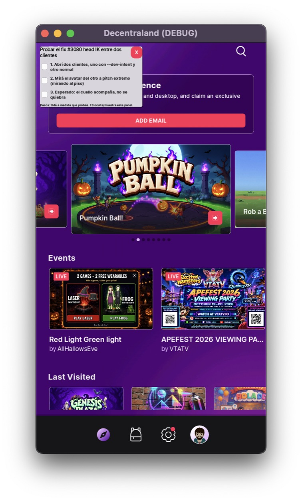

# Dev intent: telling the human why this client is open

When an agent (pi, Claude, any automation) launches the client **so a human can test
something**, the human is looking at a game window with no idea what was changed or what
"working" looks like. The prompt usually arrives in the chat, and it is gone from sight by
the time the human reaches the bug.

`--dev-intent` / `--dev-intent-file` put that intent inside the client: a card with the
title and a checklist of the expected steps, on stdout, and in the debug panel.

## Rule for agents

> Whenever you launch the client for a human to test, pass `--dev-intent` or
> `--dev-intent-file`. No exceptions: a client opened without an intent is a client the
> human has to guess about.

With a prompt long enough to need a file:

```bash
godot --path godot --dev-intent-file /tmp/pi-intent.txt "$@"
```

Through the repo's xtask (builds first, then forwards everything after `--` to Godot):

```bash
cargo run -- run -- --dev-intent-file /tmp/pi-intent.txt
```

One-liner, title and steps separated by `|`:

```bash
cargo run -- run -- --dev-intent "Fix #3080 head IK | Open two clients | Look at the other avatar at extreme pitch | Expected: the neck follows"
```

## The intent file

UTF-8. The **first non-empty line is the title**; every line starting with `- ` is an
expected step. Other lines are ignored, so prose can sit next to the checklist.

```
Fix #3080 head IK between two clients
- Open two clients, one with --dev-intent and one plain
- Look at the other avatar at extreme pitch (looking at the floor)
- Expected: the neck follows instead of breaking
```

A missing or unreadable file is not fatal: the client logs a warning and boots with no
intent. When both flags are passed, `--dev-intent-file` wins.

## What the human sees

- **Card, top-left, above the whole UI**: title, one tickable row per step, and the hint
  *"Steps: tick them as you test. F8 hides/shows this panel."*. It is the `DevIntent`
  autoload on its own CanvasLayer, so it also covers menus, the lobby and
  loading screens — some fixes are UI fixes — and it survives scene changes. Click-through
  everywhere except the checkboxes and the `X` button, so it never takes a click from the
  scene. `X` hides it, `F8` hides/shows it (ticks survive both). Nothing in the card is
  translated: the payload is the agent's own text in whatever language it wrote it, so every
  node in it is `auto_translate_mode = 2`.
- **stdout**, where the source file and then one line per step can be grepped from any log:
  ```
  [DEV-INTENT] source: --dev-intent-file /tmp/pi-intent.txt
  [DEV-INTENT] Fix #3080 head IK between two clients
  [DEV-INTENT] 1. Open two clients, one with --dev-intent and one plain
  [DEV-INTENT] 2. Look at the other avatar at extreme pitch (looking at the floor)
  [DEV-INTENT] 3. Expected: the neck follows instead of breaking
  ```
- **Debug panel** (`--debug-panel`): a "Dev Intent" tab with the full text, selectable for
  copying. The tab only exists when an intent was passed.



## From GDScript / tooling

The payload is on the CLI singleton (`Global.cli`); `Global` itself is at the gdlint
public-method cap, so nothing was added to it:

```gdscript
Global.cli.dev_intent              # raw resolved text ("" when no flag was passed)
Global.cli.get_dev_intent_title()  # title line
Global.cli.get_dev_intent_steps()  # PackedStringArray, one entry per step
```

`--dcl-help` lists both flags under `Debugging`.
